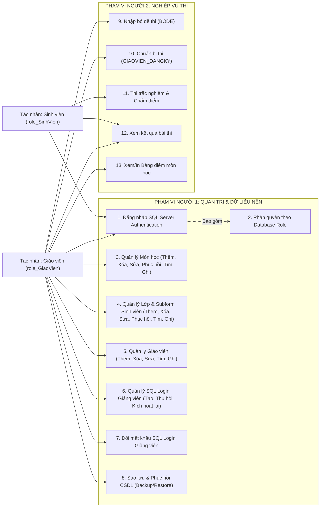
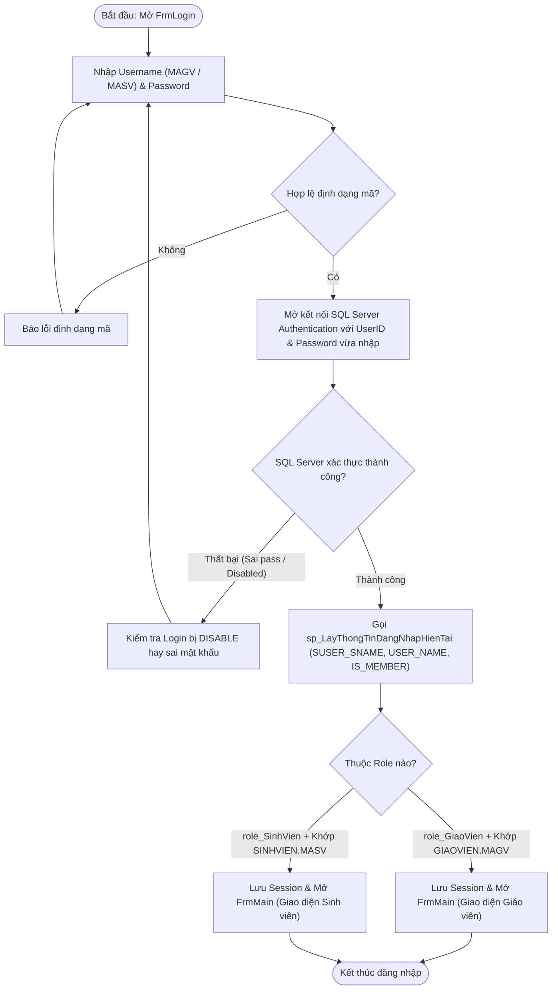

# TÀI LIỆU PHÂN TÍCH NGHIỆP VỤ HỆ THỐNG THI TRẮC NGHIỆM PTIT
*(Bám sát Đề 3 – Thi Trắc Nghiệm & Phân công Người 1 – Quản trị và Dữ liệu nền)*

---

## 1. MÔ TẢ TỔNG QUAN NGHIỆP VỤ
Hệ thống **Quản lý Thi Trắc Nghiệm PTIT** (*PTIT Multiple-Choice Examination Management System*) là ứng dụng Desktop (Windows Forms kết nối Microsoft SQL Server qua ADO.NET) phục vụ việc quản lý dữ liệu đào tạo nền tảng (Môn học, Lớp, Sinh viên, Giáo viên), quản lý tài khoản bằng **SQL Server Login & Database Role** (`role_GiaoVien`, `role_SinhVien`), biên soạn câu hỏi trắc nghiệm, đăng ký lịch thi, tổ chức thi trắc nghiệm trực tiếp trên máy tính, chấm điểm tự động, in ấn kết quả/bảng điểm và sao lưu/phục hồi cơ sở dữ liệu.

---

## 2. DANH SÁCH TÁC NHÂN (ACTORS) & DATABASE ROLE
Hệ thống có đúng **02 tác nhân (loại người dùng)** được quản lý trực tiếp bằng cơ chế bảo mật gốc của SQL Server (**SQL Server Authentication + Database Role**):

| STT | Tác nhân | SQL Server Login | Database Role | Mô tả & Quyền hạn |
|---|---|---|---|---|
| 1 | **Giáo viên (Giảng viên)** | `Username = MAGV` (VD: `GV001`, `GV002`, `GV-8-4`) | `role_GiaoVien` | Toàn quyền thao tác trên chương trình: Quản lý danh mục nền (Môn học, Lớp, Sinh viên, Giáo viên), Quản lý tài khoản SQL Login giảng viên (Tạo mới, Thu hồi, Kích hoạt lại), Đổi mật khẩu SQL Login, Sao lưu & Phục hồi CSDL (`Backup` & `Restore`), Nhập bộ đề, Chuẩn bị/Đăng ký lịch thi, Xem kết quả và Bảng điểm môn học. |
| 2 | **Sinh viên** | `Username = MASV` (VD: `SV001`..`SV006`) | `role_SinhVien` | Đăng nhập bằng Mã sinh viên (`MASV`). Chỉ được quyền: **Thi trắc nghiệm** theo lịch thi đã được giáo viên đăng ký cho lớp mình và **Xem kết quả thi / điểm của chính bản thân** (`SUSER_SNAME() = MASV`). Tuyệt đối bị chặn mọi quyền quản trị dữ liệu nền ở cả giao diện C# và SQL Server. |

---

## 3. PHẠM VI PHÂN CÔNG GIỮA NGƯỜI 1 VÀ NGƯỜI 2

### 3.1. Phạm vi của NGƯỜI 1 – Quản trị và Dữ liệu nền (Trọng tâm triển khai)
* **Cơ sở dữ liệu nền & Bảo mật SQL Server:**
  * Khởi tạo Database `TRAC_NGHIEM` giữ nguyên đúng 7 bảng theo đề bài (Không tạo bảng `TAIKHOAN` hay `VAITRO`).
  * Thiết kế và tạo 4 bảng dữ liệu gốc của Người 1: `LOP`, `MONHOC`, `SINHVIEN`, `GIAOVIEN`.
  * Thiết lập đầy đủ 3 bảng khung của Người 2 (`BODE`, `GIAOVIEN_DANGKY`, `BANGDIEM`) đúng hợp đồng khóa ngoại để tích hợp đồng bộ.
  * Thiết kế phân quyền bằng **SQL Server Database Role** (`role_GiaoVien`, `role_SinhVien`) và cơ chế **Certificate Signing** (`cert_QuanLyTaiKhoan_TracNghiem`, `cert_MasterBackupRestore_TracNghiem`) để thực hiện tạo/thu hồi/kích hoạt Login và Backup/Restore an toàn mà không cần tài khoản `sa` trong ứng dụng.
* **Chức năng phần mềm (9 chức năng):**
  1. **Đăng nhập (`FrmLogin`):** Xác thực trực tiếp bằng SQL Server Authentication theo từng người dùng (`MAGV` hoặc `MASV`), đối chiếu `SUSER_SNAME()`, `USER_NAME()`, `IS_MEMBER()` với bảng `GIAOVIEN` / `SINHVIEN`.
  2. **Phân quyền (`SessionManager` + `FrmMain` + SQL Role):** Kiểm soát quyền truy cập ở cả 3 tầng: Giao diện WinForms, Tầng nghiệp vụ BLL và Tầng SQL Server (`role_GiaoVien` / `role_SinhVien`).
  3. **Nhập môn học (`FrmMonHoc`):** Thêm, Xóa, Hiệu chỉnh (Sửa), Phục hồi (Undo + Soft Delete), Tìm kiếm, Ghi trên bảng `MONHOC`.
  4. **Nhập lớp và sinh viên (`FrmLopSinhVien`):** Thiết kế theo mô hình **Master–Detail (Subform)**. Khu vực Master quản lý `LOP` (Thêm, Xóa, Sửa, Tìm, Ghi); Subform quản lý danh sách `SINHVIEN` thuộc lớp đang chọn (Thêm, Xóa, Sửa, Phục hồi, Tìm, Ghi).
  5. **Nhập giáo viên (`FrmGiaoVien`):** Thêm, Xóa, Hiệu chỉnh (Sửa), Tìm kiếm, Ghi trên bảng `GIAOVIEN`.
  6. **Quản lý tài khoản Giảng viên (`FrmTaoTaiKhoan`):** Tạo SQL Server Login + Database User + gán `role_GiaoVien` cho giáo viên chưa có Login; Thu hồi tài khoản (`ALTER LOGIN ... DISABLE`) và Kích hoạt lại tài khoản (`ALTER LOGIN ... ENABLE`).
  7. **Đổi mật khẩu (`FrmDoiMatKhau`):** Dành cho Giảng viên đổi mật khẩu SQL Login của chính mình bằng `ALTER LOGIN ... WITH PASSWORD ... OLD_PASSWORD ...`.
  8. **Backup Database (`FrmBackupRestore`):** Sao lưu toàn bộ CSDL `TRAC_NGHIEM` ra file `.bak` (`WITH INIT` / `WITH NOINIT`).
  9. **Restore Database (`FrmBackupRestore`):** Kiểm tra file `.bak` (`RESTORE VERIFYONLY` & `HEADERONLY`) và khôi phục CSDL `TRAC_NGHIEM` an toàn (`SINGLE_USER WITH ROLLBACK IMMEDIATE` $\rightarrow$ `RESTORE WITH REPLACE, RECOVERY` $\rightarrow$ `MULTI_USER` $\rightarrow$ đồng bộ lại User/Login).

### 3.2. Phạm vi của NGƯỜI 2 – Nghiệp vụ thi (Hợp đồng tích hợp)
* **Bảng dữ liệu chịu trách nhiệm nghiệp vụ:** `BODE`, `GIAOVIEN_DANGKY`, `BANGDIEM`.
* **Chức năng phần mềm:** Nhập đề (`BODE`), Chuẩn bị thi (`GIAOVIEN_DANGKY`), Tổ chức thi & Chấm điểm (`BANGDIEM`), Xem kết quả thi, Bảng điểm môn học.

---

## 4. SƠ ĐỒ USE CASE & ACTIVITY DIAGRAM

### 4.1. Sơ đồ Use Case Tổng thể (Mermaid)

### 4.2. Sơ đồ Hoạt động (Activity Diagram) – Quy trình Đăng nhập bằng SQL Server Login

---

## 5. QUY TRÌNH CẤP SQL LOGIN CHO GIÁO VIÊN VÀ SINH VIÊN

1. **Đối với Giáo viên (`Username = MAGV`):**
   - Giáo viên được thêm hồ sơ vào bảng `dbo.GIAOVIEN`.
   - Người quản trị (Giáo viên thuộc `role_GiaoVien`) mở `FrmTaoTaiKhoan`, chọn giáo viên chưa có SQL Login, nhập mật khẩu và nhấn **Tạo tài khoản**.
   - Ứng dụng gọi `dbo.sp_TaoTaiKhoanGiaoVien` (được ký bằng chứng thư số `cert_QuanLyTaiKhoan_TracNghiem`) để thực thi `CREATE LOGIN [<MAGV>]`, `CREATE USER [<MAGV>]` và `ALTER ROLE [role_GiaoVien] ADD MEMBER [<MAGV>]`.
   - Khi cần thu hồi quyền truy cập mà không xóa dữ liệu lịch sử của giáo viên, người quản trị nhấn **Thu hồi tài khoản** (`ALTER LOGIN [<MAGV>] DISABLE`), và có thể **Kích hoạt lại tài khoản** (`ALTER LOGIN [<MAGV>] ENABLE`).
2. **Đối với Sinh viên (`Username = MASV`):**
   - Theo đề gốc, sinh viên sử dụng `MASV` làm Login Name và không tự đăng ký tài khoản.
   - Khi Giáo viên thêm sinh viên mới trên Subform (`dbo.sp_ThemSinhVien`) hoặc chạy script quản trị (`dbo.sp_CapTaiKhoanSinhVien`), hệ thống tự động tạo `SQL Login = MASV`, `Database User = MASV` và gán vào `role_SinhVien`. Khi xóa mềm sinh viên (`sp_XoaSinhVien`), Login của sinh viên tự động bị `DISABLE`; khi phục hồi (`sp_PhucHoiSinhVien`), Login được `ENABLE` trở lại.
