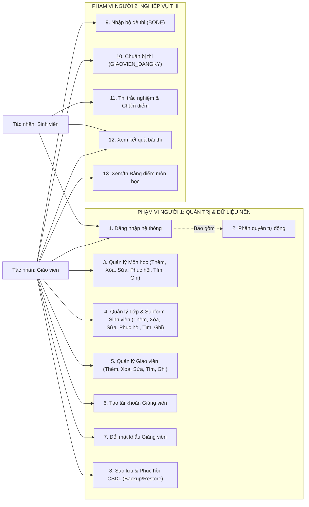
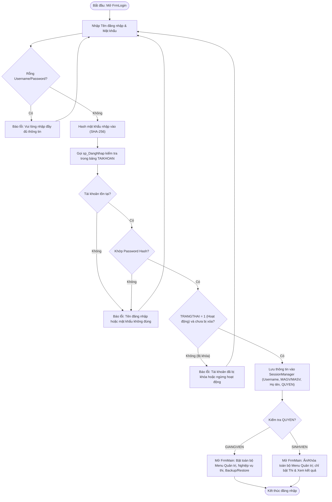

# TÀI LIỆU PHÂN TÍCH NGHIỆP VỤ HỆ THỐNG THI TRẮC NGHIỆM PTIT
*(Bám sát Đề 3 – Thi Trắc Nghiệm & Phân công Người 1 – Quản trị và Dữ liệu nền)*

---

## 1. MÔ TẢ TỔNG QUAN NGHIỆP VỤ
Hệ thống **Quản lý Thi Trắc Nghiệm PTIT** (*PTIT Multiple-Choice Examination Management System*) là ứng dụng Desktop (Windows Forms kết nối Microsoft SQL Server qua ADO.NET) phục vụ việc quản lý dữ liệu đào tạo nền tảng (Môn học, Lớp, Sinh viên, Giáo viên), quản lý tài khoản & phân quyền, biên soạn câu hỏi trắc nghiệm, đăng ký lịch thi, tổ chức thi trắc nghiệm trực tiếp trên máy tính, chấm điểm tự động và in ấn kết quả/bảng điểm.

---

## 2. DANH SÁCH TÁC NHÂN (ACTORS)
Hệ thống có đúng **02 tác nhân (loại người dùng)** theo đề gốc:

| STT | Tác nhân | Mã vai trò (`QUYEN`) | Mô tả & Quyền hạn |
|---|---|---|---|
| 1 | **Giáo viên (Giảng viên)** | `GIANGVIEN` | Được toàn quyền thao tác trên chương trình: Quản lý danh mục nền (Môn học, Lớp, Sinh viên, Giáo viên), Tạo tài khoản cho giảng viên khác, Đổi mật khẩu, Sao lưu & Phục hồi CSDL (Backup & Restore), Nhập bộ đề, Chuẩn bị/Đăng ký lịch thi, Xem kết quả và In bảng điểm môn học. |
| 2 | **Sinh viên** | `SINHVIEN` | Đăng nhập bằng Mã sinh viên (`MASV`). Chỉ được quyền: **Thi trắc nghiệm** theo lịch thi đã được giáo viên đăng ký cho lớp mình và **Xem kết quả thi / điểm của chính bản thân**. Tuyệt đối không được truy cập các chức năng quản trị hay xem điểm của sinh viên khác. |

---

## 3. PHẠM VI PHÂN CÔNG GIỮA NGƯỜI 1 VÀ NGƯỜI 2

### 3.1. Phạm vi của NGƯỜI 1 – Quản trị và Dữ liệu nền (Trọng tâm triển khai)
* **Cơ sở dữ liệu nền:**
  * Khởi tạo Database `TRAC_NGHIEM`.
  * Thiết kế và tạo 4 bảng dữ liệu gốc: `LOP`, `MONHOC`, `SINHVIEN`, `GIAOVIEN`.
  * Thiết kế và tạo bảng quản trị bảo mật: `TAIKHOAN` (kèm cơ chế lưu mật khẩu băm SHA-256, trạng thái khóa/mở) và cơ chế phục hồi dữ liệu đã xóa (Soft Delete / Undo).
  * Thiết lập đầy đủ các bảng khung của Người 2 (`BODE`, `GIAOVIEN_DANGKY`, `BANGDIEM`) đúng hợp đồng dữ liệu (Database Contract) để kiểm tra ràng buộc khóa ngoại toàn diện và bàn giao cho Người 2 dùng chung ngay.
* **Chức năng phần mềm (9 chức năng):**
  1. **Đăng nhập (`FrmLogin`):** Xác thực tài khoản Giảng viên (`TENDANGNHAP`) hoặc Sinh viên (`MASV`), kiểm tra mật khẩu băm, kiểm tra trạng thái hoạt động.
  2. **Phân quyền (`SessionManager` + `FrmMain`):** Kiểm soát quyền truy cập ở cả tầng Giao diện (ẩn/khóa menu) và tầng Nghiệp vụ (BLL).
  3. **Nhập môn học (`FrmMonHoc`):** Thêm, Xóa, Hiệu chỉnh (Sửa), Phục hồi, Tìm kiếm, Ghi trên bảng `MONHOC`.
  4. **Nhập lớp và sinh viên (`FrmLopSinhVien`):** Thiết kế theo mô hình **Master–Detail (Subform)**. Khu vực chính quản lý `LOP` (Thêm, Xóa, Sửa, Tìm, Ghi); Subform hiển thị và quản lý danh sách `SINHVIEN` thuộc lớp đang chọn (Thêm, Xóa, Sửa, Phục hồi, Tìm, Ghi).
  5. **Nhập giáo viên (`FrmGiaoVien`):** Thêm, Xóa, Hiệu chỉnh (Sửa), Tìm kiếm, Ghi trên bảng `GIAOVIEN`.
  6. **Tạo tài khoản (`FrmTaoTaiKhoan`):** Chỉ Giáo viên mới được vào và chỉ tạo tài khoản cho Giảng viên chưa có tài khoản (`1 Giảng viên - 1 Tài khoản`).
  7. **Đổi mật khẩu (`FrmDoiMatKhau`):** Dành cho Giảng viên đã được tạo tài khoản đổi mật khẩu của chính mình.
  8. **Backup Database (`FrmBackupRestore`):** Sao lưu toàn bộ CSDL `TRAC_NGHIEM` ra file `.bak`.
  9. **Restore Database (`FrmBackupRestore`):** Khôi phục CSDL `TRAC_NGHIEM` từ file `.bak` an toàn (tự động chuyển `SINGLE_USER WITH ROLLBACK IMMEDIATE` khi cần và đưa về `MULTI_USER`).

### 3.2. Phạm vi của NGƯỜI 2 – Nghiệp vụ thi (Hợp đồng tích hợp)
* **Bảng dữ liệu chịu trách nhiệm nghiệp vụ:** `BODE`, `GIAOVIEN_DANGKY`, `BANGDIEM`.
* **Chức năng phần mềm:**
  1. **Nhập đề:** Giáo viên nhập câu hỏi trắc nghiệm (A, B, C, D, Đáp án, Trình độ A/B/C) vào `BODE`.
  2. **Chuẩn bị thi:** Giáo viên đăng ký lịch thi cho lớp (`GIAOVIEN_DANGKY`), kiểm tra đủ số lượng câu hỏi trong `BODE`.
  3. **Tổ chức thi & Chấm điểm:** Sinh viên làm bài thi trắc nghiệm ngẫu nhiên (theo tỷ lệ trình độ 70%/30% nếu cần), đếm ngược thời gian, chấm điểm thang 10 và lưu chi tiết bài làm vào `BANGDIEM`.
  4. **Xem kết quả thi:** Hiển thị lại chi tiết các câu đã thi, đáp án đã chọn và đáp án đúng.
  5. **Bảng điểm môn học:** Xuất báo cáo điểm thi hết môn theo lớp, môn học và lần thi.

---

## 4. SƠ ĐỒ USE CASE & ACTIVITY DIAGRAM

### 4.1. Sơ đồ Use Case Tổng thể (Mermaid)

### 4.2. Sơ đồ Hoạt động (Activity Diagram) – Quy trình Đăng nhập & Phân quyền

---

## 5. PHÂN TÍCH VẤN ĐỀ ĐẶC BIỆT: QUY TRÌNH CẤP TÀI KHOẢN & MẬT KHẨU BAN ĐẦU CHO SINH VIÊN

### 5.1. Vấn đề đặt ra trong đề gốc
Trong đề gốc (`De2-ThiTN.doc`) có 3 quy định liên quan đến tài khoản:
1. *"Trước khi sinh viên/giáo viên sử dụng chương trình thì phải đăng ký trước. Đối với sinh viên thì `MASV` xem như là Login Name."*
2. *"9- Tạo tài khoản: cho phép tạo tài khoản cho người dùng, chỉ cho phép tạo tài khoản cho giảng viên."*
3. *"Đổi mật mã: chỉ xuất hiện các giảng viên đã được tạo tài khoản."*

**Câu hỏi nghiệp vụ phát sinh:** Nếu chức năng *"Tạo tài khoản"* chỉ dành riêng cho Giảng viên, vậy **tài khoản và mật khẩu đăng nhập của Sinh viên được sinh ra từ đâu?**

### 5.2. Phân tích 3 phương án kỹ thuật
| Phương án | Cách hoạt động | Ưu điểm | Nhược điểm |
|---|---|---|---|
| **Phương án 1: Sinh viên đăng nhập không cần mật khẩu (chỉ nhập `MASV`)** | Khi gõ `MASV`, hệ thống bỏ qua ô mật khẩu. | Đơn giản khi code. | **Vi phạm nghiêm trọng** yêu cầu bảo mật của đề (mục III.1: phải kiểm tra mật khẩu, không lưu plaintext) và sinh viên khác biết `MASV` có thể vào thi hộ/xem điểm. |
| **Phương án 2: Xác thực sinh viên trực tiếp từ bảng `SINHVIEN` bằng ngày sinh** | Không lưu sinh viên trong bảng `TAIKHOAN`, lấy `NGAYSINH` làm mật khẩu. | Không cần tạo dòng trong `TAIKHOAN`. | Không thống nhất quản lý tài khoản tập trung (không khóa được tài khoản sinh viên vi phạm quy chế, không lưu được chuỗi Hash mật khẩu chuẩn). |
| **Phương án 3 (ĐỀ XUẤT CHUẨN NHẤT): Tự động khởi tạo Tài khoản Sinh viên khi Thêm Sinh viên (trong Transaction / Trigger/SP)** | Khi Giáo viên thêm mới một Sinh viên vào bảng `SINHVIEN` ở Subform, hệ thống **tự động tạo ngay bản ghi tương ứng trong bảng `TAIKHOAN`** với: - `TENDANGNHAP = MASV` - `MATKHAU = SHA256(Mật khẩu mặc định)` (ví dụ: `"123456"` hoặc ngày sinh `ddMMyyyy`, mặc định `"123456"` để dễ kiểm thử và đồng bộ với dữ liệu mẫu hiện có) - `MASV = MASV`, `MAGV = NULL` - `QUYEN = 'SINHVIEN'`, `TRANGTHAI = 1`. | 1. **Đúng 100% đề gốc:** Form *"Tạo tài khoản"* vẫn chỉ dành riêng để tạo tài khoản cho Giảng viên. 2. Sinh viên có sẵn `Login Name = MASV` ngay khi được nhập vào lớp. 3. Mật khẩu của cả Giảng viên và Sinh viên đều được lưu dạng **Hash SHA-256** trong cùng bảng `TAIKHOAN`, hỗ trợ khóa tài khoản (`TRANGTHAI`) và kiểm tra tập trung qua một Stored Procedure `sp_DangNhap`. | Cần sử dụng `Transaction` khi Thêm/Xóa/Phục hồi sinh viên để đồng bộ trạng thái giữa bảng `SINHVIEN` và `TAIKHOAN`. (Đây lại chính là điểm cộng lớn để chứng minh kỹ thuật Transaction & Trigger trong môn Hệ QTCSDL!). |

---

## 6. QUY TẮC NGHIỆP VỤ BẮT BUỘC (BUSINESS RULES)

1. **Quy tắc Định danh & Chuẩn chuỗi:**
   - `MALOP` (`NCHAR(8)`), `MAMH` (`NCHAR(5)`), `MASV` (`NCHAR(8)`), `MAGV` (`NCHAR(8)`) là khóa chính, luôn được cắt khoảng trắng thừa (`TRIM`) và chuyển thành **CHỮ IN HOA** (`UPPER`) trước khi lưu.
   - `TENLOP` (`NVARCHAR(40)`) và `TENMH` (`NVARCHAR(40)`) là duy nhất (`UNIQUE`), không được phép trùng lặp.
2. **Quy tắc Toàn vẹn Tham chiếu (Referential Integrity) khi Xóa:**
   - **Không cho xóa Môn học (`MONHOC`)** nếu môn học đó đã có câu hỏi trong `BODE`, hoặc có lịch đăng ký trong `GIAOVIEN_DANGKY`, hoặc có điểm thi trong `BANGDIEM`.
   - **Không cho xóa Lớp (`LOP`)** nếu lớp đó đang có sinh viên (`SINHVIEN`) hoặc đã có lịch đăng ký thi (`GIAOVIEN_DANGKY`).
   - **Không cho xóa Sinh viên (`SINHVIEN`)** nếu sinh viên đó đã có lịch sử thi trong bảng `BANGDIEM`.
   - **Không cho xóa Giáo viên (`GIAOVIEN`)** nếu giáo viên đó đã biên soạn câu hỏi (`BODE`), đã đăng ký lịch thi (`GIAOVIEN_DANGKY`), hoặc đang có tài khoản đăng nhập hoạt động (`TAIKHOAN`).
3. **Quy tắc Phục hồi dữ liệu (Undo / Soft Delete):**
   - Chức năng **Phục hồi** ở Form Môn học và Subform Sinh viên kết hợp cả 2 cơ chế an toàn:
     1. **Soft Delete dưới Database (Cột `DAXOA BIT DEFAULT 0`):** Khi xóa một Môn học hoặc Sinh viên chưa có dữ liệu thi ràng buộc, hệ thống đánh dấu `DAXOA = 1` (thay vì `DELETE` vật lý làm mất hẳn dữ liệu), giúp có thể **Phục hồi** lại ngay cả khi đã tắt ứng dụng mở lại.
     2. **Undo Stack trong phiên làm việc:** Lưu lịch sử thao tác Thêm/Sửa/Xóa vừa thực hiện để người dùng bấm nút **Phục hồi** khôi phục lại trạng thái trước đó một cách trực quan.
4. **Quy tắc Bảo mật & Phân quyền:**
   - Mật khẩu tuyệt đối không lưu plaintext, bắt buộc băm bằng thuật toán **SHA-256** (64 ký tự Hex chuẩn).
   - Mỗi giảng viên chỉ được cấp tối đa **01 tài khoản** (`UNIQUE` trên `MAGV` khi `MAGV IS NOT NULL`).
   - Không ai được đổi mật khẩu của người khác; chỉ giảng viên đang đăng nhập mới đổi được mật khẩu của chính mình sau khi xác minh đúng mật khẩu hiện tại.

