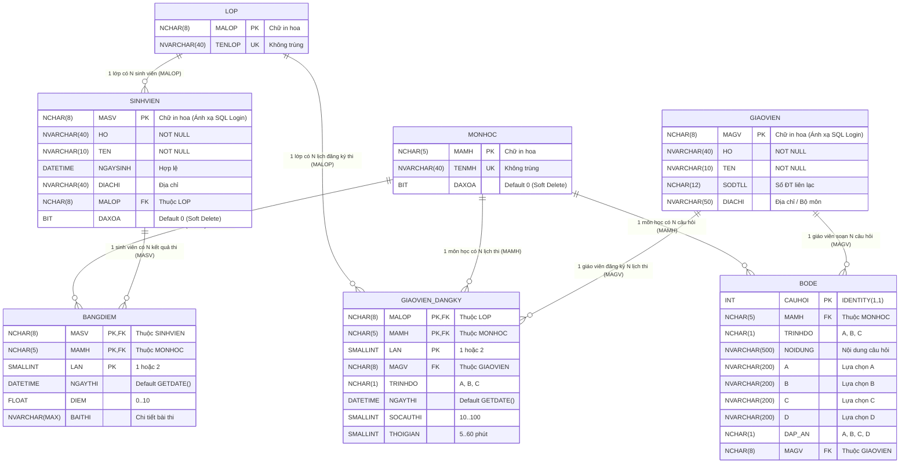

# TÀI LIỆU THIẾT KẾ CƠ SỞ DỮ LIỆU (`TRAC_NGHIEM`)
*(Giai đoạn 2: ERD, Thực thể, Quan hệ, Chuẩn hóa 1NF–2NF–3NF, Ràng buộc toàn vẹn, Bảo mật SQL Login/Role & Từ điển dữ liệu)*

---

## 1. XÁC ĐỊNH THỰC THỂ & PHÂN ĐỊNH TRÁCH NHIỆM

Cơ sở dữ liệu **`TRAC_NGHIEM`** gồm đúng **07 thực thể (bảng)** theo đề gốc (Không sử dụng bảng `TAIKHOAN` hay `VAITRO`; xác thực và phân quyền sử dụng trực tiếp **SQL Server Login + Database User + Database Role**):

| STT | Tên bảng | Phân loại | Người phụ trách | Mục đích lưu trữ |
|---|---|---|---|---|
| 1 | **`LOP`** | Dữ liệu nền (Gốc) | **Người 1** | Lưu danh mục các lớp học tại học viện (`MALOP`, `TENLOP`). |
| 2 | **`MONHOC`** | Dữ liệu nền (Gốc) | **Người 1** | Lưu danh mục các môn học tổ chức thi trắc nghiệm (`MAMH`, `TENMH`, `DAXOA`). |
| 3 | **`SINHVIEN`** | Dữ liệu nền (Gốc) | **Người 1** | Lưu hồ sơ sinh viên thuộc từng lớp (`MASV`, `HO`, `TEN`, `NGAYSINH`, `DIACHI`, `MALOP`, `DAXOA`). |
| 4 | **`GIAOVIEN`** | Dữ liệu nền (Gốc) | **Người 1** | Lưu hồ sơ giảng viên (`MAGV`, `HO`, `TEN`, `SODTLL`, `DIACHI`). |
| 5 | **`BODE`** | Nghiệp vụ thi (Gốc) | **Người 2** | Lưu ngân hàng câu hỏi trắc nghiệm do giáo viên biên soạn cho từng môn học theo trình độ (`A`, `B`, `C`). |
| 6 | **`GIAOVIEN_DANGKY`** | Nghiệp vụ thi (Gốc) | **Người 2** | Lưu lịch đăng ký tổ chức thi của giáo viên cho một lớp, một môn học ở lần thi 1 hoặc 2. |
| 7 | **`BANGDIEM`** | Nghiệp vụ thi (Gốc) | **Người 2** | Lưu kết quả điểm thi và chi tiết bài làm của sinh viên theo môn học và lần thi. |

> **Thiết kế Bảo mật & Phục hồi dữ liệu:**
> 1. **SQL Server Login, Database User & Database Role (`role_GiaoVien`, `role_SinhVien`):**
>    - Thay vì tạo bảng `TAIKHOAN` lưu mật khẩu trong bảng nghiệp vụ, hệ thống sử dụng cơ chế bảo mật gốc của **Microsoft SQL Server Authentication**.
>    - Mỗi Giáo viên có `SQL Login = Database User = MAGV`, thuộc **`role_GiaoVien`**.
>    - Mỗi Sinh viên có `SQL Login = Database User = MASV`, thuộc **`role_SinhVien`**.
> 2. **Cột `DAXOA BIT NOT NULL DEFAULT 0` trên `MONHOC` và `SINHVIEN`:** Đề gốc yêu cầu chức năng **Phục hồi** trên Form Môn học và Subform Sinh viên. Sử dụng cờ xóa mềm (`DAXOA = 1` khi xóa, `DAXOA = 0` khi phục hồi) giúp dữ liệu đã xóa được khôi phục an toàn ngay cả sau khi đóng ứng dụng, đồng thời không làm gãy các khóa ngoại lịch sử.

---

## 2. SƠ ĐỒ THỰC THỂ LIÊN KẾT – ERD (ENTITY RELATIONSHIP DIAGRAM)

---

## 3. PHÂN TÍCH MỐI QUAN HỆ (1-1, 1-N, N-N)

### 3.1. Quan hệ 1 – 1 (One-to-One) giữa Hồ sơ nghiệp vụ và SQL Server Login
1. **`GIAOVIEN` (1) — (0..1) `sys.server_principals` (`SQL Login = MAGV`):**
   - Mỗi giảng viên có tối đa 1 SQL Server Login (`name = MAGV`) và 1 Database User (`name = MAGV`) thuộc `role_GiaoVien`.
2. **`SINHVIEN` (1) — (0..1) `sys.server_principals` (`SQL Login = MASV`):**
   - Mỗi sinh viên có 1 SQL Server Login (`name = MASV`) và 1 Database User (`name = MASV`) thuộc `role_SinhVien`.

### 3.2. Quan hệ 1 – N (One-to-Many)
1. **`LOP` (1) — (N) `SINHVIEN`:** Một lớp có nhiều sinh viên, nhưng mỗi sinh viên tại một thời điểm chỉ thuộc một lớp duy nhất (`SINHVIEN.MALOP` tham chiếu `LOP.MALOP`).
2. **`MONHOC` (1) — (N) `BODE`:** Một môn học có nhiều câu hỏi trong bộ đề, mỗi câu hỏi chỉ thuộc một môn học (`BODE.MAMH` tham chiếu `MONHOC.MAMH`).
3. **`GIAOVIEN` (1) — (N) `BODE`:** Một giáo viên có thể biên soạn nhiều câu hỏi, mỗi câu hỏi do một giáo viên chịu trách nhiệm biên soạn (`BODE.MAGV` tham chiếu `GIAOVIEN.MAGV`).

### 3.3. Quan hệ N – N (Many-to-Many) đã được tách thành thực thể kết hợp
1. **Giữa `SINHVIEN` và `MONHOC` (qua bảng `BANGDIEM`):**
   - Một sinh viên thi nhiều môn học (tối đa 2 lần/môn); một môn học có nhiều sinh viên dự thi.
   - Bảng trung gian **`BANGDIEM`** giải quyết quan hệ N–N này với khóa chính tổ hợp `(MASV, MAMH, LAN)`.
2. **Giữa `LOP`, `MONHOC` và `GIAOVIEN` (qua bảng `GIAOVIEN_DANGKY`):**
   - Một lớp được đăng ký thi nhiều môn học ở các lần thi khác nhau; một môn học được tổ chức thi cho nhiều lớp.
   - Bảng trung gian **`GIAOVIEN_DANGKY`** giải quyết quan hệ N–N này với khóa chính tổ hợp `(MALOP, MAMH, LAN)`.

---

## 4. KHÓA CHÍNH (PRIMARY KEY) & KHÓA NGOẠI (FOREIGN KEY)

### 4.1. Bảng tổng hợp Khóa chính (Primary Keys)
| Bảng | Khóa chính (PK) | Loại khóa | Giải thích |
|---|---|---|---|
| `LOP` | `MALOP` | Khóa đơn | Định danh duy nhất mỗi lớp học (VD: `CNTT01`). |
| `MONHOC` | `MAMH` | Khóa đơn | Định danh duy nhất mỗi môn học (VD: `CSDL`). |
| `SINHVIEN` | `MASV` | Khóa đơn | Định danh duy nhất mỗi sinh viên (VD: `SV001`). |
| `GIAOVIEN` | `MAGV` | Khóa đơn | Định danh duy nhất mỗi giảng viên (VD: `GV001`, `GV-8-4`). |
| `BODE` | `CAUHOI` | Khóa đơn (`IDENTITY`) | Định danh duy nhất mỗi câu hỏi trong toàn bộ ngân hàng đề. |
| `GIAOVIEN_DANGKY` | `(MALOP, MAMH, LAN)` | Khóa phức hợp (3 cột) | Một lớp chỉ được đăng ký thi một môn học cụ thể ở lần thi thứ `LAN` (1 hoặc 2) đúng 1 lần. |
| `BANGDIEM` | `(MASV, MAMH, LAN)` | Khóa phức hợp (3 cột) | Một sinh viên chỉ có tối đa 1 kết quả điểm cho mỗi môn học ở lần thi thứ `LAN` (1 hoặc 2). |

### 4.2. Bảng tổng hợp 7 Khóa ngoại (Foreign Keys)
| Tên Constraint | Bảng con (Child) | Cột FK | Bảng cha (Parent) | Cột PK | Hành vi khi Xóa (`ON DELETE`) |
|---|---|---|---|---|---|
| `FK_Sinhvien_Lop` | `SINHVIEN` | `MALOP` | `LOP` | `MALOP` | `NO ACTION` (Chặn xóa lớp đang có SV) |
| `FK_BODE_Monhoc` | `BODE` | `MAMH` | `MONHOC` | `MAMH` | `NO ACTION` (Chặn xóa MH đã có đề) |
| `FK_BODE_Giaovien` | `BODE` | `MAGV` | `GIAOVIEN` | `MAGV` | `NO ACTION` (Chặn xóa GV đã soạn đề) |
| `FK_GVDK_Giaovien` | `GIAOVIEN_DANGKY` | `MAGV` | `GIAOVIEN` | `MAGV` | `NO ACTION` (Chặn xóa GV đã đăng ký thi) |
| `FK_GVDK_Lop` | `GIAOVIEN_DANGKY` | `MALOP` | `LOP` | `MALOP` | `NO ACTION` (Chặn xóa Lớp đã có lịch thi) |
| `FK_GVDK_Monhoc` | `GIAOVIEN_DANGKY` | `MAMH` | `MONHOC` | `MAMH` | `NO ACTION` (Chặn xóa MH đã có lịch thi) |
| `FK_BangDiem_Sinhvien` | `BANGDIEM` | `MASV` | `SINHVIEN` | `MASV` | `NO ACTION` (Chặn xóa SV đã có điểm thi) |
| `FK_BangDiem_Monhoc` | `BANGDIEM` | `MAMH` | `MONHOC` | `MAMH` | `NO ACTION` (Chặn xóa MH đã có điểm thi) |

---

## 5. PHÂN TÍCH VÀ CHỨNG MINH CHUẨN HÓA ĐẾN 3NF (THIRD NORMAL FORM)

### 5.1. Chứng minh Dạng chuẩn 1 (1NF - First Normal Form)
* **Định nghĩa 1NF:** Mọi thuộc tính trong bảng đều mang **giá trị nguyên tố (Atomic Value)**, không có thuộc tính đa trị hoặc thuộc tính lặp.
* **Chứng minh trong `TRAC_NGHIEM`:**
  * Họ và tên trong `SINHVIEN` và `GIAOVIEN` được tách thành 2 cột nguyên tố `HO` (`NVARCHAR(40)`) và `TEN` (`NVARCHAR(10)`).
  * Kết quả thi nhiều môn của một sinh viên được tách sang bảng `BANGDIEM(MASV, MAMH, LAN, NGAYTHI, DIEM, BAITHI)`.
  * Kết luận: Cả 7 bảng đều đạt **1NF**.

### 5.2. Chứng minh Dạng chuẩn 2 (2NF - Second Normal Form)
* **Định nghĩa 2NF:** Đạt 1NF và mọi thuộc tính không khóa đều **phụ thuộc hàm đầy đủ** vào toàn bộ khóa chính.
* **Chứng minh:**
  * Các bảng khóa đơn (`LOP`, `MONHOC`, `SINHVIEN`, `GIAOVIEN`, `BODE`) đạt 1NF nên nghiễm nhiên đạt **2NF**.
  * Bảng **`BANGDIEM`** có khóa chính $K = \{\text{MASV}, \text{MAMH}, \text{LAN}\}$:
    $$\{\text{MASV}, \text{MAMH}, \text{LAN}\} \rightarrow \{\text{NGAYTHI}, \text{DIEM}, \text{BAITHI}\}$$
    Không lưu `HO, TEN` (phụ thuộc riêng `MASV`) hay `TENMH` (phụ thuộc riêng `MAMH`) trong `BANGDIEM`.
  * Bảng **`GIAOVIEN_DANGKY`** có khóa chính $K = \{\text{MALOP}, \text{MAMH}, \text{LAN}\}$:
    $$\{\text{MALOP}, \text{MAMH}, \text{LAN}\} \rightarrow \{\text{MAGV}, \text{TRINHDO}, \text{NGAYTHI}, \text{SOCAUTHI}, \text{THOIGIAN}\}$$
    Không lưu `TENLOP` hay `TENMH` trong `GIAOVIEN_DANGKY`.
  * Kết luận: Toàn bộ CSDL đạt **2NF**.

### 5.3. Chứng minh Dạng chuẩn 3 (3NF - Third Normal Form)
* **Định nghĩa 3NF:** Đạt 2NF và không có thuộc tính không khóa nào **phụ thuộc bắc cầu (Transitive Dependency)** vào khóa chính.
* **Chứng minh bằng ví dụ tách bảng `SINHVIEN` và `LOP`:**
  * Nếu gộp `TENLOP` vào `SINHVIEN`, sẽ xuất hiện phụ thuộc bắc cầu:
    $$\text{MASV} \rightarrow \text{MALOP} \quad \text{và} \quad \text{MALOP} \rightarrow \text{TENLOP} \implies \text{MASV} \xrightarrow{\text{bắc cầu}} \text{TENLOP}$$
  * Việc tách thành `LOP(MALOP, TENLOP)` và `SINHVIEN(MASV, HO, TEN, NGAYSINH, DIACHI, MALOP, DAXOA)` loại bỏ hoàn toàn dị thường thêm, xóa, sửa.
  * Tương tự trên cả 7 bảng, mọi phụ thuộc hàm không tầm thường $X \rightarrow Y$ đều có $X$ là siêu khóa $\Rightarrow$ **CSDL `TRAC_NGHIEM` đạt chuẩn 3NF (và BCNF)**.

---

## 6. TỪ ĐIỂN DỮ LIỆU (DATA DICTIONARY – 7 BẢNG)

### 6.1. Bảng `LOP` (Người 1 quản lý)
| Tên cột | Kiểu dữ liệu | Null | Ràng buộc | Mô tả |
|---|---|---|---|---|
| `MALOP` | `NCHAR(8)` | `NOT NULL` | `PRIMARY KEY`, `CHECK (UPPER)` | Mã lớp học (in hoa, tối đa 8 ký tự). |
| `TENLOP` | `NVARCHAR(40)` | `NOT NULL` | `UNIQUE` | Tên lớp học (duy nhất, tiếng Việt). |

### 6.2. Bảng `MONHOC` (Người 1 quản lý)
| Tên cột | Kiểu dữ liệu | Null | Ràng buộc | Mô tả |
|---|---|---|---|---|
| `MAMH` | `NCHAR(5)` | `NOT NULL` | `PRIMARY KEY`, `CHECK (UPPER)` | Mã môn học (in hoa, tối đa 5 ký tự). |
| `TENMH` | `NVARCHAR(40)` | `NOT NULL` | `UNIQUE` | Tên môn học (duy nhất, tiếng Việt). |
| `DAXOA` | `BIT` | `NOT NULL` | `DEFAULT 0` | Cờ xóa mềm phục vụ chức năng Phục hồi (`0`: Đang dùng, `1`: Đã xóa tạm). |

### 6.3. Bảng `SINHVIEN` (Người 1 quản lý)
| Tên cột | Kiểu dữ liệu | Null | Ràng buộc | Mô tả |
|---|---|---|---|---|
| `MASV` | `NCHAR(8)` | `NOT NULL` | `PRIMARY KEY`, `CHECK (UPPER)` | Mã số sinh viên (dùng làm SQL Login Name cho SV). |
| `HO` | `NVARCHAR(40)` | `NOT NULL` | | Họ và tên đệm của sinh viên. |
| `TEN` | `NVARCHAR(10)` | `NOT NULL` | | Tên gọi của sinh viên. |
| `NGAYSINH` | `DATETIME` | `NULL` | `CHECK (< GETDATE())` | Ngày tháng năm sinh của sinh viên. |
| `DIACHI` | `NVARCHAR(40)` | `NULL` | | Địa chỉ cư trú của sinh viên. |
| `MALOP` | `NCHAR(8)` | `NOT NULL` | `FOREIGN KEY (LOP.MALOP)` | Mã lớp mà sinh viên đang theo học. |
| `DAXOA` | `BIT` | `NOT NULL` | `DEFAULT 0` | Cờ xóa mềm phục vụ chức năng Phục hồi (`0`: Đang học, `1`: Đã xóa tạm). |

### 6.4. Bảng `GIAOVIEN` (Người 1 quản lý)
| Tên cột | Kiểu dữ liệu | Null | Ràng buộc | Mô tả |
|---|---|---|---|---|
| `MAGV` | `NCHAR(8)` | `NOT NULL` | `PRIMARY KEY`, `CHECK (UPPER)` | Mã giảng viên (dùng làm SQL Login Name cho GV, hỗ trợ cả mã có dấu `-` như `GV-8-4`). |
| `HO` | `NVARCHAR(40)` | `NOT NULL` | | Họ và tên đệm của giảng viên. |
| `TEN` | `NVARCHAR(10)` | `NOT NULL` | | Tên gọi của giảng viên. |
| `SODTLL` | `NCHAR(12)` | `NULL` | | Số điện thoại liên lạc (10–11 chữ số). |
| `DIACHI` | `NVARCHAR(50)` | `NULL` | | Địa chỉ liên hệ / bộ môn của giảng viên. |

### 6.5. Bảng `BODE` (Người 2 quản lý – Hợp đồng tích hợp)
| Tên cột | Kiểu dữ liệu | Null | Ràng buộc | Mô tả |
|---|---|---|---|---|
| `CAUHOI` | `INT` | `NOT NULL` | `PRIMARY KEY`, `IDENTITY(1,1)` | Mã số câu hỏi tự động tăng. |
| `MAMH` | `NCHAR(5)` | `NOT NULL` | `FOREIGN KEY (MONHOC.MAMH)` | Mã môn học của câu hỏi. |
| `TRINHDO` | `NCHAR(1)` | `NOT NULL` | `CHECK IN ('A', 'B', 'C')` | Trình độ: `A`, `B`, `C`. |
| `NOIDUNG` | `NVARCHAR(500)` | `NOT NULL` | | Nội dung câu dẫn của câu hỏi trắc nghiệm. |
| `A`, `B`, `C`, `D` | `NVARCHAR(200)` | `NOT NULL` | | Bốn phương án lựa chọn A, B, C, D. |
| `DAP_AN` | `NCHAR(1)` | `NOT NULL` | `CHECK IN ('A', 'B', 'C', 'D')` | Đáp án đúng của câu hỏi. |
| `MAGV` | `NCHAR(8)` | `NOT NULL` | `FOREIGN KEY (GIAOVIEN.MAGV)` | Mã giáo viên biên soạn câu hỏi. |

### 6.6. Bảng `GIAOVIEN_DANGKY` (Người 2 quản lý – Hợp đồng tích hợp)
| Tên cột | Kiểu dữ liệu | Null | Ràng buộc | Mô tả |
|---|---|---|---|---|
| `MALOP` | `NCHAR(8)` | `NOT NULL` | `PK (1/3)`, `FK (LOP.MALOP)` | Mã lớp được đăng ký thi. |
| `MAMH` | `NCHAR(5)` | `NOT NULL` | `PK (2/3)`, `FK (MONHOC.MAMH)` | Mã môn học được đăng ký thi. |
| `LAN` | `SMALLINT` | `NOT NULL` | `PK (3/3)`, `CHECK (1..2)` | Lần thi (chỉ nhận giá trị 1 hoặc 2). |
| `MAGV` | `NCHAR(8)` | `NOT NULL` | `FK (GIAOVIEN.MAGV)` | Mã giáo viên thực hiện đăng ký lịch thi. |
| `TRINHDO` | `NCHAR(1)` | `NOT NULL` | `CHECK IN ('A', 'B', 'C')` | Trình độ đề thi áp dụng cho lớp. |
| `NGAYTHI` | `DATETIME` | `NOT NULL` | `DEFAULT GETDATE()` | Ngày giờ tổ chức thi. |
| `SOCAUTHI` | `SMALLINT` | `NOT NULL` | `CHECK (10..100)` | Số lượng câu hỏi thi (từ 10 đến 100 câu). |
| `THOIGIAN` | `SMALLINT` | `NOT NULL` | `CHECK (5..60)` | Thời gian làm bài tính bằng phút (5 đến 60 phút). |

### 6.7. Bảng `BANGDIEM` (Người 2 quản lý – Hợp đồng tích hợp)
| Tên cột | Kiểu dữ liệu | Null | Ràng buộc | Mô tả |
|---|---|---|---|---|
| `MASV` | `NCHAR(8)` | `NOT NULL` | `PK (1/3)`, `FK (SINHVIEN.MASV)` | Mã sinh viên dự thi. |
| `MAMH` | `NCHAR(5)` | `NOT NULL` | `PK (2/3)`, `FK (MONHOC.MAMH)` | Mã môn học dự thi. |
| `LAN` | `SMALLINT` | `NOT NULL` | `PK (3/3)`, `CHECK (1..2)` | Lần dự thi (1 hoặc 2). |
| `NGAYTHI` | `DATETIME` | `NOT NULL` | `DEFAULT GETDATE()` | Ngày giờ thực tế sinh viên làm bài thi. |
| `DIEM` | `FLOAT` | `NOT NULL` | `CHECK (0..10)` | Điểm số bài thi (thang điểm 10). |
| `BAITHI` | `NVARCHAR(MAX)` | `NULL` | | Lưu danh sách mã câu hỏi và đáp án sinh viên đã chọn để xem lại kết quả. |
