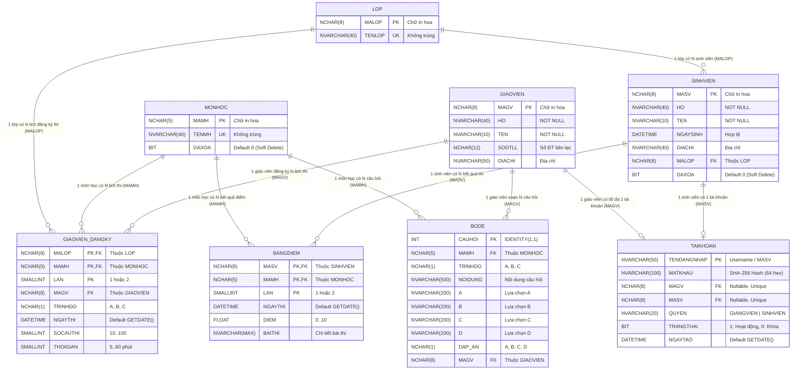

# TÀI LIỆU THIẾT KẾ CƠ SỞ DỮ LIỆU (`TRAC_NGHIEM`)
*(Giai đoạn 2: ERD, Thực thể, Quan hệ, Chuẩn hóa 1NF–2NF–3NF, Ràng buộc toàn vẹn & Từ điển dữ liệu)*

---

## 1. XÁC ĐỊNH THỰC THỂ & PHÂN ĐỊNH TRÁCH NHIỆM

Cơ sở dữ liệu **`TRAC_NGHIEM`** gồm **08 thực thể (bảng)**, được chia rõ ràng theo phạm vi quản lý:

| STT | Tên bảng | Phân loại | Người phụ trách | Mục đích lưu trữ |
|---|---|---|---|---|
| 1 | **`LOP`** | Dữ liệu nền (Gốc) | **Người 1** | Lưu danh mục các lớp học tại học viện (`MALOP`, `TENLOP`). |
| 2 | **`MONHOC`** | Dữ liệu nền (Gốc) | **Người 1** | Lưu danh mục các môn học tổ chức thi trắc nghiệm (`MAMH`, `TENMH`, `DAXOA`). |
| 3 | **`SINHVIEN`** | Dữ liệu nền (Gốc) | **Người 1** | Lưu hồ sơ sinh viên thuộc từng lớp (`MASV`, `HO`, `TEN`, `NGAYSINH`, `DIACHI`, `MALOP`, `DAXOA`). |
| 4 | **`GIAOVIEN`** | Dữ liệu nền (Gốc) | **Người 1** | Lưu hồ sơ giảng viên (`MAGV`, `HO`, `TEN`, `SODTLL`, `DIACHI`). |
| 5 | **`TAIKHOAN`** | Quản trị & Bảo mật (Bổ sung) | **Người 1** | Lưu thông tin đăng nhập, mật khẩu băm SHA-256, phân quyền (`GIANGVIEN`/`SINHVIEN`) và trạng thái khóa/mở (`TRANGTHAI`). |
| 6 | **`BODE`** | Nghiệp vụ thi (Gốc) | **Người 2** | Lưu ngân hàng câu hỏi trắc nghiệm do giáo viên biên soạn cho từng môn học theo trình độ (`A`, `B`, `C`). |
| 7 | **`GIAOVIEN_DANGKY`** | Nghiệp vụ thi (Gốc) | **Người 2** | Lưu lịch đăng ký tổ chức thi của giáo viên cho một lớp, một môn học ở lần thi 1 hoặc 2. |
| 8 | **`BANGDIEM`** | Nghiệp vụ thi (Gốc) | **Người 2** | Lưu kết quả điểm thi và chi tiết bài làm của sinh viên theo môn học và lần thi. |

> **Lý do bổ sung bảng `TAIKHOAN` và cột `DAXOA` (`MONHOC`, `SINHVIEN`):**
> 1. **Bảng `TAIKHOAN`:** Đề gốc yêu cầu chức năng *Đăng nhập*, *Phân quyền (Giáo viên/Sinh viên)*, *Tạo tài khoản cho giảng viên*, *Đổi mật khẩu*, nhưng không có cột mật khẩu trong bảng `GIAOVIEN` hay `SINHVIEN`. Việc tách bảng `TAIKHOAN` riêng biệt giúp:
>    - Không làm biến dạng cấu trúc các bảng cốt lõi (`GIAOVIEN`, `SINHVIEN`).
>    - Quản lý tập trung mật khẩu băm (`SHA-256`), quyền hạn (`QUYEN`) và trạng thái hoạt động (`TRANGTHAI`).
> 2. **Cột `DAXOA BIT NOT NULL DEFAULT 0` trên `MONHOC` và `SINHVIEN`:** Đề gốc yêu cầu chức năng **Phục hồi** trên Form Môn học và Subform Sinh viên. Sử dụng cờ xóa mềm (`DAXOA = 1` khi xóa, `DAXOA = 0` khi phục hồi) giúp dữ liệu đã xóa được khôi phục an toàn ngay cả sau khi đóng ứng dụng, đồng thời không làm gãy các khóa ngoại lịch sử.

---

## 2. SƠ ĐỒ THỰC THỂ LIÊN KẾT – ERD (ENTITY RELATIONSHIP DIAGRAM)

---

## 3. PHÂN TÍCH MỐI QUAN HỆ (1-1, 1-N, N-N)

### 3.1. Quan hệ 1 – 1 (One-to-One)
1. **`GIAOVIEN` (1) — (0..1) `TAIKHOAN`:**
   - Một giảng viên có tối đa 1 tài khoản đăng nhập; một tài khoản giảng viên chỉ thuộc về duy nhất 1 giảng viên (`MAGV`).
   - Thực thi trong SQL Server bằng Khóa ngoại `FK_TaiKhoan_Giaovien` kết hợp **Filtered Unique Index** `UX_TaiKhoan_MAGV ON TAIKHOAN(MAGV) WHERE MAGV IS NOT NULL`.
2. **`SINHVIEN` (1) — (0..1) `TAIKHOAN`:**
   - Một sinh viên có 1 tài khoản đăng nhập (`TENDANGNHAP = MASV`); một tài khoản sinh viên chỉ thuộc về duy nhất 1 sinh viên (`MASV`).
   - Thực thi bằng Khóa ngoại `FK_TaiKhoan_Sinhvien` kết hợp **Filtered Unique Index** `UX_TaiKhoan_MASV ON TAIKHOAN(MASV) WHERE MASV IS NOT NULL`.

### 3.2. Quan hệ 1 – N (One-to-Many)
1. **`LOP` (1) — (N) `SINHVIEN`:** Một lớp có nhiều sinh viên, nhưng mỗi sinh viên tại một thời điểm chỉ thuộc một lớp duy nhất (`SINHVIEN.MALOP` tham chiếu `LOP.MALOP`).
2. **`MONHOC` (1) — (N) `BODE`:** Một môn học có nhiều câu hỏi trong bộ đề, mỗi câu hỏi chỉ thuộc một môn học (`BODE.MAMH` tham chiếu `MONHOC.MAMH`).
3. **`GIAOVIEN` (1) — (N) `BODE`:** Một giáo viên có thể biên soạn nhiều câu hỏi, mỗi câu hỏi do một giáo viên chịu trách nhiệm biên soạn (`BODE.MAGV` tham chiếu `GIAOVIEN.MAGV`).

### 3.3. Quan hệ N – N (Many-to-Many) đã được tách thành thực thể kết hợp
1. **Giữa `SINHVIEN` và `MONHOC` (qua bảng `BANGDIEM`):**
   - Một sinh viên thi nhiều môn học (tối đa 2 lần/môn); một môn học có nhiều sinh viên dự thi.
   - Bảng trung gian **`BANGDIEM`** giải quyết quan hệ N–N này với khóa chính tổ hợp `(MASV, MAMH, LAN)`.
2. **Giữa `LOP`, `MONHOC` và `GIAOVIEN` (qua bảng `GIAOVIEN_DANGKY`):**
   - Một lớp được đăng ký thi nhiều môn học ở các lần thi khác nhau; một môn học được tổ chức thi cho nhiều lớp.
   - Bảng trung gian **`GIAOVIEN_DANGKY`** giải quyết quan hệ N–N này với khóa chính tổ hợp `(MALOP, MAMH, LAN)`.

---

## 4. KHÓA CHÍNH (PRIMARY KEY) & KHÓA NGOẠI (FOREIGN KEY)

### 4.1. Bảng tổng hợp Khóa chính (Primary Keys)
| Bảng | Khóa chính (PK) | Loại khóa | Giải thích |
|---|---|---|---|
| `LOP` | `MALOP` | Khóa đơn | Định danh duy nhất mỗi lớp học (VD: `CNTT01`). |
| `MONHOC` | `MAMH` | Khóa đơn | Định danh duy nhất mỗi môn học (VD: `CSDL`). |
| `SINHVIEN` | `MASV` | Khóa đơn | Định danh duy nhất mỗi sinh viên (VD: `N21DC001`). |
| `GIAOVIEN` | `MAGV` | Khóa đơn | Định danh duy nhất mỗi giảng viên (VD: `GV001`). |
| `TAIKHOAN` | `TENDANGNHAP` | Khóa đơn | Định danh duy nhất tên đăng nhập hệ thống. |
| `BODE` | `CAUHOI` | Khóa đơn (Tự tăng `IDENTITY`) | Định danh duy nhất mỗi câu hỏi trong toàn bộ ngân hàng đề. |
| `GIAOVIEN_DANGKY` | `(MALOP, MAMH, LAN)` | Khóa phức hợp (3 cột) | Một lớp chỉ được đăng ký thi một môn học cụ thể ở lần thi thứ `LAN` (1 hoặc 2) đúng 1 lần. |
| `BANGDIEM` | `(MASV, MAMH, LAN)` | Khóa phức hợp (3 cột) | Một sinh viên chỉ có tối đa 1 kết quả điểm cho mỗi môn học ở lần thi thứ `LAN` (1 hoặc 2). |

### 4.2. Bảng tổng hợp Khóa ngoại (Foreign Keys)
| Tên Constraint | Bảng con (Child) | Cột FK | Bảng cha (Parent) | Cột PK | Hành vi khi Xóa (`ON DELETE`) |
|---|---|---|---|---|---|
| `FK_Sinhvien_Lop` | `SINHVIEN` | `MALOP` | `LOP` | `MALOP` | `NO ACTION` (Chặn xóa lớp đang có SV) |
| `FK_TaiKhoan_Giaovien` | `TAIKHOAN` | `MAGV` | `GIAOVIEN` | `MAGV` | `NO ACTION` (Chặn xóa GV đang có TK) |
| `FK_TaiKhoan_Sinhvien` | `TAIKHOAN` | `MASV` | `SINHVIEN` | `MASV` | `NO ACTION` (Bảo vệ toàn vẹn TK) |
| `FK_BODE_Monhoc` | `BODE` | `MAMH` | `MONHOC` | `MAMH` | `NO ACTION` (Chặn xóa MH đã có đề) |
| `FK_BODE_Giaovien` | `BODE` | `MAGV` | `GIAOVIEN` | `MAGV` | `NO ACTION` (Chặn xóa GV đã soạn đề) |
| `FK_GVDK_Giaovien` | `GIAOVIEN_DANGKY` | `MAGV` | `GIAOVIEN` | `MAGV` | `NO ACTION` (Chặn xóa GV đã đăng ký thi) |
| `FK_GVDK_Lop` | `GIAOVIEN_DANGKY` | `MALOP` | `LOP` | `MALOP` | `NO ACTION` (Chặn xóa Lớp đã có lịch thi) |
| `FK_GVDK_Monhoc` | `GIAOVIEN_DANGKY` | `MAMH` | `MONHOC` | `MAMH` | `NO ACTION` (Chặn xóa MH đã có lịch thi) |
| `FK_BangDiem_Sinhvien` | `BANGDIEM` | `MASV` | `SINHVIEN` | `MASV` | `NO ACTION` (Chặn xóa SV đã có điểm thi) |
| `FK_BangDiem_Monhoc` | `BANGDIEM` | `MAMH` | `MONHOC` | `MAMH` | `NO ACTION` (Chặn xóa MH đã có điểm thi) |

---

## 5. PHÂN TÍCH VÀ CHỨNG MINH CHUẨN HÓA ĐẾN 3NF (THIRD NORMAL FORM)

Đây là phần trọng tâm thường được giảng viên hỏi khi bảo vệ đồ án môn Hệ quản trị CSDL.

### 5.1. Khái niệm Phụ thuộc hàm (Functional Dependency - FD)
Cho quan hệ $R$, tập thuộc tính $X$ xác định hàm tập thuộc tính $Y$ (ký hiệu $X \rightarrow Y$) nếu mỗi giá trị của $X$ trong $R$ luôn xác định duy nhất một giá trị của $Y$.

### 5.2. Chứng minh Dạng chuẩn 1 (1NF - First Normal Form)
* **Định nghĩa 1NF:** Một lược đồ quan hệ đạt chuẩn 1NF nếu mọi thuộc tính trong bảng đều mang **giá trị nguyên tố (Atomic Value)**, không có thuộc tính đa trị (Multi-valued) hoặc thuộc tính lặp.
* **Chứng minh bằng ví dụ trong `TRAC_NGHIEM`:**
  * Trong bảng `SINHVIEN` và `GIAOVIEN`, họ và tên đã được tách thành 2 cột nguyên tố riêng biệt là `HO` (`NVARCHAR(40)`) và `TEN` (`NVARCHAR(10)`) để phục vụ sắp xếp theo tên chính xác.
  * Trong bảng `SINHVIEN`, nếu một sinh viên thi nhiều môn, ta **không** tạo các cột lặp `MAMH1, DIEM1, MAMH2, DIEM2` trong bảng `SINHVIEN`, mà tách sang bảng `BANGDIEM(MASV, MAMH, LAN, NGAYTHI, DIEM, BAITHI)`.
  * Kết luận: Toàn bộ 8 bảng đều chỉ chứa giá trị đơn tại mỗi ô giao giữa dòng và cột $\Rightarrow$ **Đạt 1NF**.

### 5.3. Chứng minh Dạng chuẩn 2 (2NF - Second Normal Form)
* **Định nghĩa 2NF:** Đạt 1NF và mọi thuộc tính không khóa (non-prime attribute) đều **phụ thuộc hàm đầy đủ** vào toàn bộ khóa chính (không tồn tại phụ thuộc bộ phận / một phần vào khóa chính tổ hợp).
* **Chứng minh trên các bảng có Khóa đơn (`LOP`, `MONHOC`, `SINHVIEN`, `GIAOVIEN`, `TAIKHOAN`, `BODE`):**
  * Vì khóa chính chỉ gồm 1 thuộc tính duy nhất (ví dụ `MASV` trong `SINHVIEN`), không thể có tập con thực sự của khóa chính $\Rightarrow$ Mọi bảng khóa đơn đạt 1NF thì nghiễm nhiên **Đạt 2NF**.
* **Chứng minh trên 2 bảng có Khóa phức hợp (`GIAOVIEN_DANGKY` và `BANGDIEM`):**
  1. Xét bảng **`BANGDIEM`** có khóa chính $K = \{\text{MASV}, \text{MAMH}, \text{LAN}\}$:
     - Các thuộc tính không khóa là: $\text{NGAYTHI}, \text{DIEM}, \text{BAITHI}$.
     - Phụ thuộc hàm thực tế:
       $$\{\text{MASV}, \text{MAMH}, \text{LAN}\} \rightarrow \{\text{NGAYTHI}, \text{DIEM}, \text{BAITHI}\}$$
     - Giả sử nếu ta lưu thêm cột `HO_TEN_SV` hoặc `TENMH` vào bảng `BANGDIEM`, khi đó sẽ xuất hiện phụ thuộc bộ phận:
       $$\text{MASV} \rightarrow \text{HO\_TEN\_SV} \quad (\text{chỉ phụ thuộc một phần khóa chính } K)$$
       $$\text{MAMH} \rightarrow \text{TENMH} \quad (\text{chỉ phụ thuộc một phần khóa chính } K)$$
     - Nhờ ta đã **tách `HO, TEN` sang bảng `SINHVIEN`** và **tách `TENMH` sang bảng `MONHOC`**, nên trong `BANGDIEM` không còn bất kỳ thuộc tính nào phụ thuộc vào riêng `MASV` hay riêng `MAMH`.
  2. Xét bảng **`GIAOVIEN_DANGKY`** có khóa chính $K = \{\text{MALOP}, \text{MAMH}, \text{LAN}\}$:
     - Các thuộc tính không khóa: $\text{MAGV}, \text{TRINHDO}, \text{NGAYTHI}, \text{SOCAUTHI}, \text{THOIGIAN}$.
     - Tất cả các thuộc tính này đều phụ thuộc vào cả bộ ba $(\text{MALOP}, \text{MAMH}, \text{LAN})$: Cùng một lớp `MALOP` và môn `MAMH`, nhưng ở lần thi `LAN = 1` và `LAN = 2` có thể do giáo viên khác nhau đăng ký, ngày thi khác nhau, thời gian khác nhau:
       $$\{\text{MALOP}, \text{MAMH}, \text{LAN}\} \rightarrow \{\text{MAGV}, \text{TRINHDO}, \text{NGAYTHI}, \text{SOCAUTHI}, \text{THOIGIAN}\}$$
     - Không có cột `TENLOP` (vì $\text{MALOP} \rightarrow \text{TENLOP}$) hay `TENMH` (vì $\text{MAMH} \rightarrow \text{TENMH}$) nằm trong bảng này.
  * Kết luận: Không có phụ thuộc hàm bộ phận vào khóa chính $\Rightarrow$ **Toàn bộ CSDL đạt 2NF**.

### 5.4. Chứng minh Dạng chuẩn 3 (3NF - Third Normal Form)
* **Định nghĩa 3NF:** Đạt 2NF và không có thuộc tính không khóa nào **phụ thuộc bắc cầu (Transitive Dependency)** vào khóa chính (tức là không có $X \rightarrow Y$ và $Y \rightarrow Z$ trong đó $X$ là khóa chính, $Y$ không phải khóa ứng viên, $Z$ là thuộc tính không khóa).
* **Chứng minh bằng ví dụ tách bảng `SINHVIEN` và `LOP`:**
  * Giả sử ta gộp chung thông tin Lớp vào bảng `SINHVIEN(MASV, HO, TEN, NGAYSINH, DIACHI, MALOP, TENLOP)`.
  * Khi đó ta có chuỗi phụ thuộc bắc cầu:
    $$\text{MASV} \rightarrow \text{MALOP} \quad \text{và} \quad \text{MALOP} \rightarrow \text{TENLOP} \implies \text{MASV} \xrightarrow{\text{bắc cầu}} \text{TENLOP}$$
  * Hệ quả nếu không tách bảng (Dị thường dữ liệu - Anomalies):
    1. **Dị thường thêm (Insertion Anomaly):** Khi mới thành lập lớp `D21CQCN01` chưa có sinh viên nào, ta không thể lưu tên lớp vào CSDL vì chưa có `MASV` (khóa chính).
    2. **Dị thường xóa (Deletion Anomaly):** Nếu lớp chỉ có 1 sinh viên và ta xóa sinh viên đó, thông tin tên lớp cũng bị mất theo.
    3. **Dị thường cập nhật (Update Anomaly):** Nếu lớp có 80 sinh viên và đổi tên lớp, ta phải cập nhật 80 dòng thay vì 1 dòng.
  * **Cách giải quyết trong thiết kế của chúng ta:** Tách thành 2 bảng `LOP(MALOP, TENLOP)` và `SINHVIEN(MASV, HO, TEN, NGAYSINH, DIACHI, MALOP)`.
* **Kiểm tra phụ thuộc hàm trên từng bảng sau khi tách:**
  1. `LOP`: $\text{MALOP} \rightarrow \text{TENLOP}$ (Vế trái là siêu khóa).
  2. `MONHOC`: $\text{MAMH} \rightarrow \{\text{TENMH}, \text{DAXOA}\}$ (Vế trái là siêu khóa).
  3. `SINHVIEN`: $\text{MASV} \rightarrow \{\text{HO}, \text{TEN}, \text{NGAYSINH}, \text{DIACHI}, \text{MALOP}, \text{DAXOA}\}$ (Giữa `HO`, `TEN`, `NGAYSINH`, `DIACHI`, `MALOP` hoàn toàn độc lập, không suy diễn ra nhau).
  4. `GIAOVIEN`: $\text{MAGV} \rightarrow \{\text{HO}, \text{TEN}, \text{SODTLL}, \text{DIACHI}\}$.
  5. `TAIKHOAN`: $\text{TENDANGNHAP} \rightarrow \{\text{MATKHAU}, \text{MAGV}, \text{MASV}, \text{QUYEN}, \text{TRANGTHAI}, \text{NGAYTAO}\}$.
  6. `BODE`: $\text{CAUHOI} \rightarrow \{\text{MAMH}, \text{TRINHDO}, \text{NOIDUNG}, \text{A}, \text{B}, \text{C}, \text{D}, \text{DAP\_AN}, \text{MAGV}\}$.
  7. `GIAOVIEN_DANGKY`: $\{\text{MALOP}, \text{MAMH}, \text{LAN}\} \rightarrow \{\text{MAGV}, \text{TRINHDO}, \text{NGAYTHI}, \text{SOCAUTHI}, \text{THOIGIAN}\}$.
  8. `BANGDIEM`: $\{\text{MASV}, \text{MAMH}, \text{LAN}\} \rightarrow \{\text{NGAYTHI}, \text{DIEM}, \text{BAITHI}\}$.
* **Kết luận:** Mọi phụ thuộc hàm không tầm thường trong cả 8 bảng đều có vế trái là một Siêu khóa (Superkey), không tồn tại phụ thuộc hàm bắc cầu $\Rightarrow$ **CSDL `TRAC_NGHIEM` đạt chuẩn 3NF (và đạt luôn BCNF)**.

---

## 6. THIẾT KẾ CÁC RÀNG BUỘC TOÀN VẸN (CONSTRAINTS)

Để SQL Server tự bảo vệ dữ liệu ngay cả khi có truy vấn trực tiếp từ SSMS, chúng ta thiết lập đầy đủ 6 loại ràng buộc:

1. **Ràng buộc `PRIMARY KEY`:** Trên cả 8 bảng (`PK_Lop`, `PK_Monhoc`, `PK_Sinhvien`, `PK_Giaovien`, `PK_TaiKhoan`, `PK_BODE`, `PK_Giaovien_Dangky`, `PK_BangDiem`).
2. **Ràng buộc `FOREIGN KEY`:** 10 khóa ngoại kết nối chặt chẽ giữa dữ liệu nền của Người 1 và dữ liệu thi của Người 2 (xem mục 4.2).
3. **Ràng buộc `UNIQUE`:**
   - `UQ_Lop_TenLop`: Không cho phép 2 lớp trùng tên (`TENLOP`).
   - `UQ_Monhoc_TenMH`: Không cho phép 2 môn học trùng tên (`TENMH`).
   - `UX_TaiKhoan_MAGV`: Filtered Unique Index đảm bảo mỗi `MAGV` chỉ xuất hiện tối đa 1 lần trong `TAIKHOAN`.
   - `UX_TaiKhoan_MASV`: Filtered Unique Index đảm bảo mỗi `MASV` chỉ xuất hiện tối đa 1 lần trong `TAIKHOAN`.
4. **Ràng buộc `NOT NULL`:** Bắt buộc nhập đối với tất cả các cột khóa chính, tên lớp, tên môn học, họ và tên sinh viên/giáo viên, mật khẩu, quyền, trạng thái.
5. **Ràng buộc `CHECK`:**
   - `CK_Lop_MaLop_Upper`: `MALOP = UPPER(MALOP) AND LEN(LTRIM(RTRIM(MALOP))) > 0` (Mã lớp bắt buộc chữ in hoa và không rỗng).
   - `CK_Monhoc_MaMH_Upper`: `MAMH = UPPER(MAMH) AND LEN(LTRIM(RTRIM(MAMH))) > 0`.
   - `CK_Sinhvien_MaSV_Upper`: `MASV = UPPER(MASV) AND LEN(LTRIM(RTRIM(MASV))) > 0`.
   - `CK_Sinhvien_NgaySinh`: `NGAYSINH IS NULL OR (NGAYSINH >= '1950-01-01' AND NGAYSINH < GETDATE())` (Ngày sinh hợp lệ).
   - `CK_Giaovien_MaGV_Upper`: `MAGV = UPPER(MAGV) AND LEN(LTRIM(RTRIM(MAGV))) > 0`.
   - `CK_TaiKhoan_Quyen`: `QUYEN IN (N'GIANGVIEN', N'SINHVIEN')`.
   - `CK_TaiKhoan_LienKet`: `(QUYEN = N'GIANGVIEN' AND MAGV IS NOT NULL AND MASV IS NULL) OR (QUYEN = N'SINHVIEN' AND MASV IS NOT NULL AND MAGV IS NULL)` (Đảm bảo tài khoản liên kết đúng loại người dùng).
   - `CK_BODE_TrinhDo`: `TRINHDO IN ('A', 'B', 'C')`.
   - `CK_BODE_DapAn`: `DAP_AN IN ('A', 'B', 'C', 'D')`.
   - `CK_GVDK_TrinhDo`: `TRINHDO IN ('A', 'B', 'C')`.
   - `CK_GVDK_Lan`: `LAN >= 1 AND LAN <= 2`.
   - `CK_GVDK_SoCauThi`: `SOCAUTHI >= 10 AND SOCAUTHI <= 100`.
   - `CK_GVDK_ThoiGian`: `THOIGIAN >= 5 AND THOIGIAN <= 60`.
   - `CK_BangDiem_Lan`: `LAN >= 1 AND LAN <= 2`.
   - `CK_BangDiem_Diem`: `DIEM >= 0 AND DIEM <= 10`.
6. **Ràng buộc `DEFAULT`:**
   - `MONHOC.DAXOA`: `DEFAULT (0)`.
   - `SINHVIEN.DAXOA`: `DEFAULT (0)`.
   - `TAIKHOAN.TRANGTHAI`: `DEFAULT (1)`.
   - `TAIKHOAN.NGAYTAO`: `DEFAULT (GETDATE())`.
   - `GIAOVIEN_DANGKY.NGAYTHI`: `DEFAULT (GETDATE())`.
   - `BANGDIEM.NGAYTHI`: `DEFAULT (GETDATE())`.

---

## 7. TỪ ĐIỂN DỮ LIỆU (DATA DICTIONARY)

### 7.1. Bảng `LOP` (Người 1 quản lý)
| Tên cột | Kiểu dữ liệu | Null | Ràng buộc | Mô tả |
|---|---|---|---|---|
| `MALOP` | `NCHAR(8)` | `NOT NULL` | `PRIMARY KEY`, `CHECK (UPPER)` | Mã lớp học (in hoa, tối đa 8 ký tự). |
| `TENLOP` | `NVARCHAR(40)` | `NOT NULL` | `UNIQUE` | Tên lớp học (duy nhất, tiếng Việt). |

### 7.2. Bảng `MONHOC` (Người 1 quản lý)
| Tên cột | Kiểu dữ liệu | Null | Ràng buộc | Mô tả |
|---|---|---|---|---|
| `MAMH` | `NCHAR(5)` | `NOT NULL` | `PRIMARY KEY`, `CHECK (UPPER)` | Mã môn học (in hoa, tối đa 5 ký tự). |
| `TENMH` | `NVARCHAR(40)` | `NOT NULL` | `UNIQUE` | Tên môn học (duy nhất, tiếng Việt). |
| `DAXOA` | `BIT` | `NOT NULL` | `DEFAULT 0` | Cờ xóa mềm phục vụ chức năng Phục hồi (`0`: Đang dùng, `1`: Đã xóa tạm). |

### 7.3. Bảng `SINHVIEN` (Người 1 quản lý)
| Tên cột | Kiểu dữ liệu | Null | Ràng buộc | Mô tả |
|---|---|---|---|---|
| `MASV` | `NCHAR(8)` | `NOT NULL` | `PRIMARY KEY`, `CHECK (UPPER)` | Mã số sinh viên (dùng làm Login Name cho SV). |
| `HO` | `NVARCHAR(40)` | `NOT NULL` | | Họ và tên đệm của sinh viên. |
| `TEN` | `NVARCHAR(10)` | `NOT NULL` | | Tên gọi của sinh viên. |
| `NGAYSINH` | `DATETIME` | `NULL` | `CHECK (< GETDATE())` | Ngày tháng năm sinh của sinh viên. |
| `DIACHI` | `NVARCHAR(40)` | `NULL` | | Địa chỉ cư trú của sinh viên. |
| `MALOP` | `NCHAR(8)` | `NOT NULL` | `FOREIGN KEY (LOP.MALOP)` | Mã lớp mà sinh viên đang theo học. |
| `DAXOA` | `BIT` | `NOT NULL` | `DEFAULT 0` | Cờ xóa mềm phục vụ chức năng Phục hồi (`0`: Đang học, `1`: Đã xóa tạm). |

### 7.4. Bảng `GIAOVIEN` (Người 1 quản lý)
| Tên cột | Kiểu dữ liệu | Null | Ràng buộc | Mô tả |
|---|---|---|---|---|
| `MAGV` | `NCHAR(8)` | `NOT NULL` | `PRIMARY KEY`, `CHECK (UPPER)` | Mã giảng viên (in hoa, tối đa 8 ký tự). |
| `HO` | `NVARCHAR(40)` | `NOT NULL` | | Họ và tên đệm của giảng viên. |
| `TEN` | `NVARCHAR(10)` | `NOT NULL` | | Tên gọi của giảng viên. |
| `SODTLL` | `NCHAR(12)` | `NULL` | | Số điện thoại liên lạc (10–11 chữ số). |
| `DIACHI` | `NVARCHAR(50)` | `NULL` | | Địa chỉ liên hệ / bộ môn của giảng viên. |

### 7.5. Bảng `TAIKHOAN` (Người 1 quản lý – Bảng bảo mật bổ sung)
| Tên cột | Kiểu dữ liệu | Null | Ràng buộc | Mô tả |
|---|---|---|---|---|
| `TENDANGNHAP` | `NVARCHAR(50)` | `NOT NULL` | `PRIMARY KEY` | Tên đăng nhập (Với SV thì bằng `MASV`). |
| `MATKHAU` | `NVARCHAR(100)` | `NOT NULL` | | Chuỗi băm mật khẩu SHA-256 (64 ký tự Hex). |
| `MAGV` | `NCHAR(8)` | `NULL` | `FK (GIAOVIEN.MAGV)`, `UNIQUE` | Liên kết tới giảng viên (nếu là TK giảng viên). |
| `MASV` | `NCHAR(8)` | `NULL` | `FK (SINHVIEN.MASV)`, `UNIQUE` | Liên kết tới sinh viên (nếu là TK sinh viên). |
| `QUYEN` | `NVARCHAR(20)` | `NOT NULL` | `CHECK IN ('GIANGVIEN','SINHVIEN')` | Vai trò phân quyền trên hệ thống. |
| `TRANGTHAI` | `BIT` | `NOT NULL` | `DEFAULT 1` | `1`: Đang hoạt động, `0`: Bị khóa đăng nhập. |
| `NGAYTAO` | `DATETIME` | `NOT NULL` | `DEFAULT GETDATE()` | Thời điểm khởi tạo tài khoản. |

### 7.6. Bảng `BODE` (Người 2 quản lý – Hợp đồng tích hợp)
| Tên cột | Kiểu dữ liệu | Null | Ràng buộc | Mô tả |
|---|---|---|---|---|
| `CAUHOI` | `INT` | `NOT NULL` | `PRIMARY KEY`, `IDENTITY(1,1)` | Mã số câu hỏi tự động tăng. |
| `MAMH` | `NCHAR(5)` | `NOT NULL` | `FOREIGN KEY (MONHOC.MAMH)` | Mã môn học của câu hỏi. |
| `TRINHDO` | `NCHAR(1)` | `NOT NULL` | `CHECK IN ('A', 'B', 'C')` | Trình độ: `A` (ĐH chuyên ngành), `B` (ĐH không CN), `C` (Cao đẳng). |
| `NOIDUNG` | `NVARCHAR(500)` | `NOT NULL` | | Nội dung câu dẫn của câu hỏi trắc nghiệm. |
| `A` | `NVARCHAR(200)` | `NOT NULL` | | Phương án lựa chọn A. |
| `B` | `NVARCHAR(200)` | `NOT NULL` | | Phương án lựa chọn B. |
| `C` | `NVARCHAR(200)` | `NOT NULL` | | Phương án lựa chọn C. |
| `D` | `NVARCHAR(200)` | `NOT NULL` | | Phương án lựa chọn D. |
| `DAP_AN` | `NCHAR(1)` | `NOT NULL` | `CHECK IN ('A', 'B', 'C', 'D')` | Đáp án đúng của câu hỏi. |
| `MAGV` | `NCHAR(8)` | `NOT NULL` | `FOREIGN KEY (GIAOVIEN.MAGV)` | Mã giáo viên biên soạn câu hỏi. |

### 7.7. Bảng `GIAOVIEN_DANGKY` (Người 2 quản lý – Hợp đồng tích hợp)
| Tên cột | Kiểu dữ liệu | Null | Ràng buộc | Mô tả |
|---|---|---|---|---|
| `MALOP` | `NCHAR(8)` | `NOT NULL` | `PK (1/3)`, `FK (LOP.MALOP)` | Mã lớp được đăng ký thi. |
| `MAMH` | `NCHAR(5)` | `NOT NULL` | `PK (2/3)`, `FK (MONHOC.MAMH)` | Mã môn học được đăng ký thi. |
| `LAN` | `SMALLINT` | `NOT NULL` | `PK (3/3)`, `CHECK (1..2)` | Lần thi (chỉ nhận giá trị 1 hoặc 2). |
| `MAGV` | `NCHAR(8)` | `NOT NULL` | `FK (GIAOVIEN.MAGV)` | Mã giáo viên thực hiện đăng ký lịch thi. |
| `TRINHDO` | `NCHAR(1)` | `NOT NULL` | `CHECK IN ('A', 'B', 'C')` | Trình độ đề thi áp dụng cho lớp. |
| `NGAYTHI` | `DATETIME` | `NOT NULL` | `DEFAULT GETDATE()` | Ngày giờ tổ chức thi. |
| `SOCAUTHI` | `SMALLINT` | `NOT NULL` | `CHECK (10..100)` | Số lượng câu hỏi thi (từ 10 đến 100 câu). |
| `THOIGIAN` | `SMALLINT` | `NOT NULL` | `CHECK (5..60)` | Thời gian làm bài tính bằng phút (5 đến 60 phút). |

### 7.8. Bảng `BANGDIEM` (Người 2 quản lý – Hợp đồng tích hợp)
| Tên cột | Kiểu dữ liệu | Null | Ràng buộc | Mô tả |
|---|---|---|---|---|
| `MASV` | `NCHAR(8)` | `NOT NULL` | `PK (1/3)`, `FK (SINHVIEN.MASV)` | Mã sinh viên dự thi. |
| `MAMH` | `NCHAR(5)` | `NOT NULL` | `PK (2/3)`, `FK (MONHOC.MAMH)` | Mã môn học dự thi. |
| `LAN` | `SMALLINT` | `NOT NULL` | `PK (3/3)`, `CHECK (1..2)` | Lần dự thi (1 hoặc 2). |
| `NGAYTHI` | `DATETIME` | `NOT NULL` | `DEFAULT GETDATE()` | Ngày giờ thực tế sinh viên làm bài thi. |
| `DIEM` | `FLOAT` | `NOT NULL` | `CHECK (0..10)` | Điểm số bài thi (thang điểm 10). |
| `BAITHI` | `NVARCHAR(MAX)` | `NULL` | | Lưu danh sách mã câu hỏi và đáp án sinh viên đã chọn để xem lại kết quả. |

